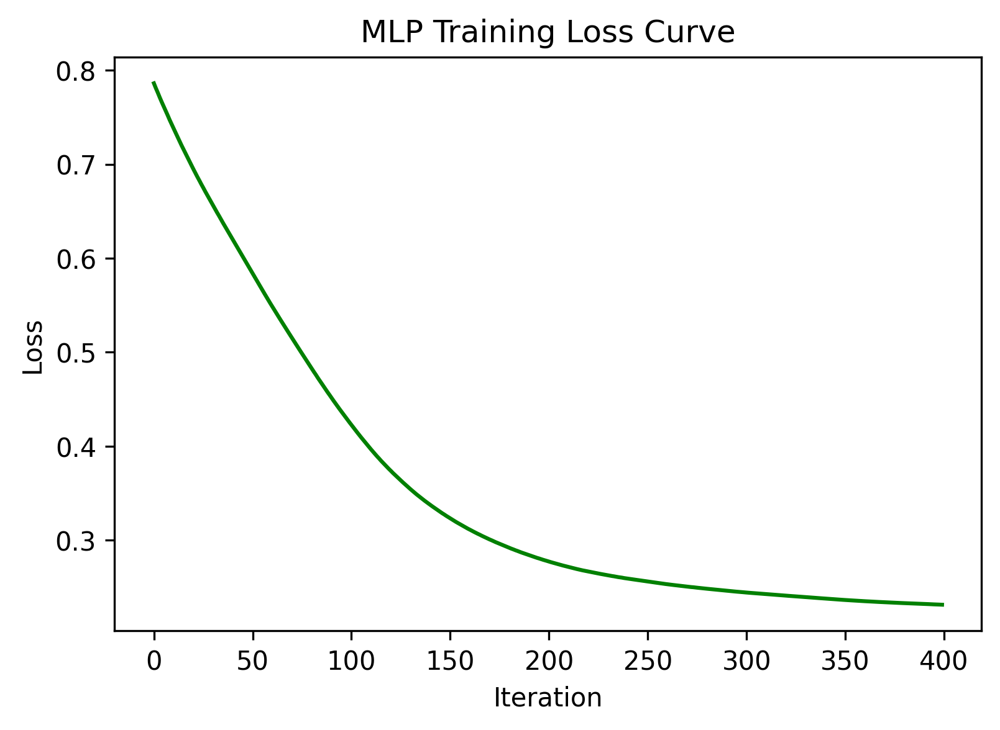
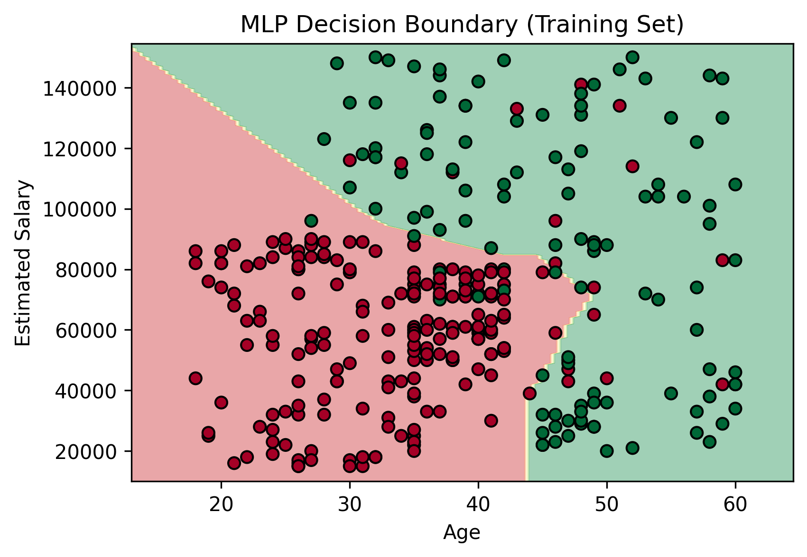

# Sales Prediction Using Multi-Layer Perceptron

A machine learning project that predicts whether a customer will purchase a product based on their **Age** and **Estimated Salary**, using a Multi-Layer Perceptron (MLP) classification model built with scikit-learn.

## 📌 Overview
This project uses the **Social Network Ads** dataset to train a neural network classifier that predicts customer purchase behavior. It covers the complete ML workflow — data preprocessing, feature scaling, model training, evaluation, and visualization of the training loss curve and decision boundary.

## 🛠️ Tech Stack
- Python
- pandas, NumPy
- scikit-learn
- Matplotlib

## 📊 Dataset
- **Features:** Age, Estimated Salary
- **Target:** Purchased (0 = No, 1 = Yes)
- **Source:** [Social Network Ads Dataset](https://www.kaggle.com/) (Kaggle)

## ⚙️ Workflow
1. Data loading and preprocessing
2. Missing-value inspection
3. Train/test split (80% training, 20% testing)
4. Feature scaling using `StandardScaler`
5. Model training using `MLPClassifier` with two hidden layers (8, 8)
6. Prediction on the test dataset
7. Evaluation — Confusion Matrix, Accuracy, Precision, Recall, F1 Score
8. Visualization — training loss curve and decision boundary

## 📈 Results
- **Accuracy:** 93.75%
- **Precision (weighted):** 93.75%
- **Recall (weighted):** 93.75%
- **F1 Score (weighted):** 93.75%

## 🖼️ Visualizations

### Training Loss Curve


*Shows how the model's training loss changes over iterations.*

### Decision Boundary


*Visualizes how the trained MLP model separates purchase outcomes based on Age and Estimated Salary.*

## 🚀 How to Run
1. Clone the repository.
2. Install dependencies:

   ```bash
   pip install pandas numpy scikit-learn matplotlib
   ```

3. Ensure `customer_dataset.csv` is available in the correct directory.
4. Open `Sales_Prediction_Using_Multi_Layer_Perceptron.ipynb` in Jupyter Notebook or Google Colab and run all cells.

## 👤 Author
Nazma Begum — [GitHub](https://github.com/Nijhumtara)
